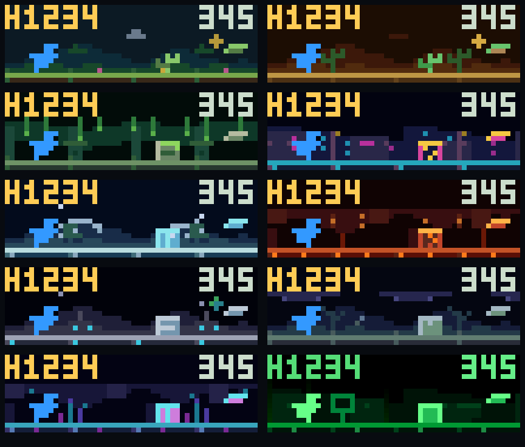

# Dino Runner

A standalone dinosaur runner for the AWTRIX NG TC002’s 52×16 display, with turn-based multiplayer, a local top five and ten scrolling pixel worlds.



Rows show grassland/desert, jungle/neon city, ice/volcano, moon/storm and crystal/Matrix.

## Install and play

1. Enable scripting on your TC002 and open its web UI.
2. Create a script named `dino_runner` on **Scripts**. Paste [dino_runner.be](dino_runner.be) and save it.
3. Hold Select on the clock for half a second. Choose **Scripts → Dino Runner**. You can also press **Start** on its web UI row.
4. Choose **Solo** or **2 Players**. In multiplayer, choose **Shared** or **Separate** controls.
5. At **P1 READY** or **P2 READY**, press A or the clock’s Select button to begin the countdown.

The game stays out of automatic app rotation. Leaving it returns to your clock apps. It needs no game server or MQTT.

For an existing installation, use the installer below to preserve an enabled old Matrix setting. When replacing the source by hand, first note that setting, then select **World mode: fixed → Fixed world: 10** after saving. Existing colour and sound settings keep their values when you update the same script name.

```sh
python3 tools/install.py http://YOUR-CLOCK-IP --name YOUR-EXISTING-SCRIPT-NAME
```

The installer backs up existing source and settings into the ignored `backups/` folder before updating. It also uploads the game's sounds from [sounds/](sounds/) (the eggshell cracks of the countdown and the hatching roar) into the script's folder, skipping files the clock already holds unchanged. A hand-pasted script has no MP3s and plays synthesised sounds instead. Use the device’s normal backup feature if you also want a full data backup. The new leaderboard starts empty on its first launch.

## Controls

| Action | Controller or phone | Clock |
|---|---|---|
| Browse menu / change initial | D-pad left/right | Left/right |
| Confirm / ready / retry | A | Select |
| Jump | A or D-pad up | Select |
| Higher jump | Hold jump for 400 ms | Hold Select briefly, below the clock’s 500 ms exit threshold |
| Duck | Hold B or D-pad down | Hold right |
| Pause | START | Left |
| Resume | A or START | Select |
| Previous initial / back | B | Hold left during initials entry |
| Quit | SELECT, or the Quit menu entry | Hold Select for half a second |

Menu actions require release before another press counts. A held during the countdown does not make the dino jump as the run starts.

**Shared** controls let players pass one controller, one phone or the clock buttons between turns. **Separate** controls use a controller or phone for each player. On controller loss or changed player slots, the game pauses. The active player must confirm with A to bind the replacement input and resume.

## A match and its records

Each player gets one run on the same obstacle course. The second runner sees a `T` target distance and a brief marker when passing it. Equal displayed distances produce a draw. Results alternate the winner and each player’s score. Choose **Rematch** for a new course with reversed starting order, or **Menu**.

Qualifying players enter three initials after both turns. Solo and multiplayer share five saved records. Older equal scores rank ahead of newer ones. **High Score** in the menu browses the entries. Leaving a run before it ends does not save it. Pause stops the whole scene, including scenery, particles and transitions.

The running HUD shows up to 9,999; final results and the leaderboard retain the full integer score.

## Settings

Open the game’s settings on the web UI’s **Apps** tab.

| Group | Settings |
|---|---|
| Players | P1 / solo dino colour, default `#3399FF`; P2 colour, default `#FF3355` |
| Worlds | Auto/fixed world, fixed world 1–10, scrolling scenery, parallax intensity, ambient effects and density |
| Worlds | Grassland daylight tint |
| Sound | Game sounds and volume |
| Scores | Reset high scores, applied once on the next launch |
| Diagnostics | Debug logging, off by default |

Matrix uses green dinos for both players. **P1 READY** and **P2 READY** identify turns. World names and detailed art direction are in [Worlds](docs/WORLDS.md).

Gameplay rules are fixed: 30 px/s starting speed, 100% type and distance randomness using the original algorithms, a day/night change every 500 pixels and a compounded 5% speed increase at each change. Auto mode changes worlds every 1,000 pixels. Fixed mode keeps one world while speed and day/night milestones continue. World changes never increase speed a second time.

## Development and verification

Use macOS or Linux with Python 3 and a C compiler. Supply a local AWTRIX NG checkout to build the test interpreter:

```sh
python3 tools/build_host.py ../awtrix-ng
python3 -m unittest discover -s tests -v
python3 tools/render_previews.py
python3 tools/make_sounds.py   # regenerates sounds/*.mp3; needs the lame encoder
```

The tests run the actual Berry game against device-service mocks. The host links the AWTRIX checkout’s Berry VM; it does not copy firmware sources into this repository. Preview PNGs are generated from the game renderer at 52×16, then enlarged without smoothing. See [Verification](docs/developers/verification.md) for measurements and outstanding TC002 checks.

The initial Git commit preserves the supplied game. [Provenance](PROVENANCE.md) records the sources and license status. The source repository is [RumbleInTheJungle/awtrix-dino-runner](https://github.com/RumbleInTheJungle/awtrix-dino-runner).

## License

Dino Runner is free for any noncommercial use under the [PolyForm Noncommercial License 1.0.0](LICENSE.md), the same license AWTRIX NG uses. Hobby, personal, educational and charitable use are all covered. Commercial use needs permission.
